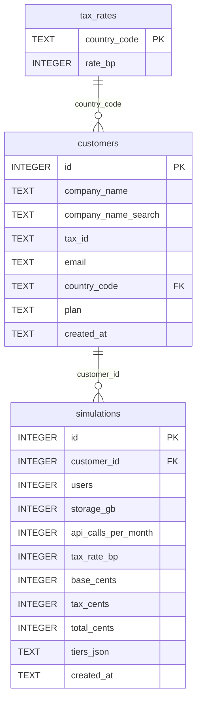

# SaaS-O-Matic — Especificación funcional

> Herramienta interna para simular y presupuestar suscripciones SaaS multi-divisa.
> Stack: Node.js + TypeScript, SQLite, React.

**Convenciones**

- Cada requisito tiene un ID `RF-XX`, un título y una definición con la forma "La herramienta debe…".
- Lo que no está decidido aparece como **[PENDIENTE]**.
- Todos los importes del backend están en céntimos de EUR, como enteros y sin coma flotante.
- La conversión de divisa es solo de visualización y se hace en el frontend.

---

## Changelog
- v0.1 - Versión inicial a partir de mis decisiones (04-prompts/01-spec-inicial.md)
- v1.0 — Aplicada la revisión propia y la cruzada (05-review-log.md (Fase 1))
- v1.1 — Aplicada la revisión de arquitectura (05-review-log.md (Fase 2)): R-69, R-70, R-71 y R-76
- v1.2 — Node 24 LTS en lugar de 22 (05-review-log.md (Fase 4)): R-95


## 1. Requisitos funcionales

### 1.1 Clientes — alta (backend)

| ID | Título | Definición |
|---|---|---|
| RF-01 | Alta de cliente | La herramienta debe permitir registrar un cliente corporativo mediante `POST /customers`, con cinco campos obligatorios: nombre de empresa, identificador fiscal, email de contacto, país y plan. |
| RF-02 | Normalización del nombre | La herramienta debe normalizar el nombre de empresa a Unicode NFC, eliminar los espacios iniciales y finales y colapsar cada secuencia de espacios internos en un único U+0020. Se considera espacio cualquier carácter `\s` Unicode (incluidos NBSP y U+2009). Tras normalizar, debe exigir una longitud de 2 a 100 code points (`[...s].length`, igual que `length()` de SQLite). Debe rechazar con `INVALID_FORMAT` los caracteres de las categorías `\p{Cc}` (control), `\p{Cf}` (formato, p. ej. U+200B o U+202E) y `\p{Cs}` (surrogates sueltos), asumiendo que esto excluye los emojis compuestos con ZWJ. El resto de caracteres Unicode se acepta y el valor se guarda sin sanear el HTML. |
| RF-03 | Normalización del email | La herramienta debe eliminar los espacios iniciales y finales del email y convertirlo a minúsculas. Debe exigir un máximo de 254 code points y validar el formato con `z.email()` de zod 4 (versión fijada), sin regex propio. |
| RF-04 | Normalización del identificador fiscal | La herramienta debe eliminar del identificador fiscal cualquier espacio `\s` Unicode, los guiones y los puntos, y convertirlo a mayúsculas. Tras normalizar, debe exigir que sea alfanumérico (`A–Z`, `0–9`, comprobado después de pasar a mayúsculas) y tenga entre 5 y 20 code points, y guardar el valor normalizado. |
| RF-05 | Validación de identificador español | La herramienta debe validar, cuando el país sea `ES`, que el identificador normalizado sea un DNI, un NIE (X/Y/Z), un CIF o un NIF especial (K/L/M) válido según el algoritmo oficial de control. El tipo se deduce del formato y no se guarda. En el CIF, el carácter de control se acepta como dígito o como letra según la regla oficial de cada letra inicial. Un identificador con el prefijo `ES` (NIF-IVA) se rechaza. |
| RF-06 | Validación de identificador no español | La herramienta debe aplicar, cuando el país no sea `ES`, solo la validación genérica de RF-04, sin algoritmo de control. |
| RF-07 | Unicidad fiscal | La herramienta debe rechazar con 409 un alta cuyo par (país, identificador normalizado) ya exista. El email y el nombre de empresa no son únicos. |
| RF-08 | Países soportados | La herramienta debe aceptar solo los códigos ISO 3166-1 alpha-2 presentes en la tabla de tasas (`ES`, `FR`, `DE`, `IT`, `PT`, `NL`, `GB`) y rechazar cualquier otro con 422. |
| RF-09 | Planes | La herramienta debe aceptar solo los planes `STARTER`, `BUSINESS` y `ENTERPRISE`, y rechazar cualquier otro valor con 422. El plan es informativo y no interviene en el cálculo del coste. |
| RF-10 | Inmutabilidad del cliente | La herramienta no debe exponer operaciones de edición ni de borrado de clientes. |

### 1.2 Clientes — consulta (backend)

| ID | Título | Definición |
|---|---|---|
| RF-11 | Búsqueda de clientes | La herramienta debe ofrecer `GET /customers?search=`, que devuelve los clientes cuyo nombre o identificador fiscal contiene el texto buscado, combinando ambos criterios con OR. Los caracteres `\`, `%` y `_` del texto buscado se escapan y la consulta usa `LIKE ? ESCAPE '\'`, de modo que se buscan literalmente. |
| RF-12 | Búsqueda por nombre | La herramienta debe buscar por nombre con coincidencia parcial, insensible a mayúsculas y a acentos (la "ñ" equivale a "n"), sobre una columna auxiliar normalizada. |
| RF-13 | Búsqueda por identificador | La herramienta debe aplicar al texto buscado solo las transformaciones de RF-04, sin sus validaciones (el único límite es el máximo de 100 caracteres de `search`), y buscar coincidencias parciales sobre el identificador normalizado. Si `search` queda vacío tras el trim, se devuelven todos los clientes (RF-14). Si la rama de identificador normaliza a vacío (p. ej. `-` o `.`), se omite y solo se busca por nombre. |
| RF-14 | Búsqueda vacía | La herramienta debe devolver todos los clientes, paginados, cuando `search` esté vacío o ausente. |
| RF-15 | Orden de búsqueda | La herramienta debe ordenar los resultados de búsqueda con `ORDER BY company_name_search, id`, para que el orden no dependa de mayúsculas ni acentos y la paginación sea determinista. |
| RF-16 | Detalle de cliente | La herramienta debe devolver un cliente mediante `GET /customers/:id`, o un 404 si no existe. |
| RF-17 | Catálogo de países | La herramienta debe ofrecer `GET /countries`, que devuelve los países soportados leídos de la tabla de tasas. |

### 1.3 Simulaciones (backend)

| ID | Título | Definición |
|---|---|---|
| RF-18 | Registro de simulación | La herramienta debe registrar mediante `POST /simulations` una simulación con `customer_id`, usuarios activos, almacenamiento (GB) y llamadas a la API (por mes). Debe calcular el coste y persistir las entradas y el resultado. |
| RF-19 | Cliente inexistente | La herramienta debe rechazar con 404 una simulación cuyo `customer_id` no exista. |
| RF-20 | Rangos de entrada | La herramienta debe exigir que los tres campos numéricos sean números JSON enteros, sin decimales ni negativos, dentro de estos rangos: usuarios de 1 a 1000, almacenamiento de 0 a 100 000 GB y llamadas de 0 a 1 000 000 al mes. Fuera de tipo o de rango debe responder 422. |
| RF-21 | Cálculo por tramos | La herramienta debe calcular la base mensual de forma acumulativa. Los usuarios 1–10 se cobran a 1000 céntimos cada uno, los usuarios 11–50 a 800 céntimos y los usuarios 51 en adelante a 500 céntimos. Los tramos son contiguos y no se solapan. Los precios son constantes del módulo de dominio `pricing` y no se guardan en base de datos. La trazabilidad de lo cobrado la da el desglose persistido en cada simulación (RF-24). |
| RF-22 | Cálculo del impuesto | La herramienta debe calcular el impuesto como `half_up(base × tasa)` en céntimos, con la tasa del país del cliente leída de la tabla de tasas, y el total como `base + impuesto`. |
| RF-23 | Conceptos sin coste | La herramienta debe guardar el almacenamiento y las llamadas a la API sin incluirlos en el cálculo del coste. |
| RF-24 | Persistencia del resultado | La herramienta debe guardar la base, el impuesto y el total en céntimos de EUR, junto con la tasa aplicada en ese momento y el desglose por tramos aplicado. Así, un cambio posterior de la tasa o de los precios no altera las simulaciones guardadas. |
| RF-25 | Inmutabilidad de la simulación | La herramienta no debe permitir modificar ni borrar una simulación guardada. Un cambio requiere registrar una simulación nueva. |
| RF-26 | Previsualización | La herramienta debe ofrecer `POST /simulations/preview`, con el mismo body, las mismas validaciones y el mismo cálculo que `POST /simulations`, y devolver el resultado sin persistir nada. |
| RF-27 | Historial de simulaciones | La herramienta debe devolver las simulaciones de un cliente mediante `GET /customers/:id/simulations`, ordenadas de la más reciente a la más antigua y paginadas, o un 404 si el cliente no existe. |

### 1.4 Transversales (backend)

| ID | Título | Definición |
|---|---|---|
| RF-28 | Paginación | La herramienta debe paginar los listados con los parámetros `page` (por defecto 1) y `pageSize` (por defecto 20, máximo 100), y devolver `{ items, page, pageSize, total }`. Debe responder 422 si `page < 1`, si `pageSize` está fuera de 1–100 o si alguno de los dos no es un entero. |
| RF-29 | Esquema estricto | La herramienta debe rechazar con 422 cualquier body con campos no definidos en el contrato. |
| RF-30 | Formato de error uniforme | La herramienta debe responder todos los errores con `{ error: { code, message, details: [{ field, issue }] } }`. |
| RF-31 | Códigos de error | La herramienta debe responder con los códigos HTTP y los `error.code` del catálogo de la sección 3.2. |
| RF-32 | Tasas configurables | La herramienta debe leer las tasas de impuesto de una tabla de la base de datos. Valores iniciales: ES 21 %, FR 20 %, DE 19 %, IT 22 %, PT 23 % (continental), NL 21 % y GB 20 %, almacenadas en puntos básicos (2100 = 21 %). |
| RF-33 | Marcas de tiempo | La herramienta debe registrar `created_at` en ISO 8601 UTC en clientes y simulaciones, con identificadores enteros autoincrementales. |

### 1.5 Frontend

| ID | Título | Definición |
|---|---|---|
| RF-34 | Buscador y dashboard | La herramienta debe ofrecer un dashboard formado por un buscador por nombre de empresa o identificador fiscal, el listado paginado de resultados y un botón de alta de cliente, sin KPIs. El buscador lanza la búsqueda con un debounce de 300 ms y cada cambio de texto vuelve a la página 1. |
| RF-35 | Detalle en tarjetas | La herramienta debe mostrar en tarjetas responsive los datos del cliente y su historial paginado de simulaciones. Cada simulación muestra fecha, usuarios, GB, llamadas, base, impuesto, total y tasa aplicada, con el desglose por tramos en un desplegable. |
| RF-36 | Formulario de alta de cliente | La herramienta debe ofrecer un formulario de registro de clientes con nombre de empresa, identificador fiscal, email, país y plan. Debe mostrar asociados a cada campo los errores de validación que devuelva `POST /customers`, incluido el de duplicado (409). Antes de medir longitudes aplica el trim y el colapso de espacios, y el mensaje de error definitivo es siempre el del backend (3.7). |
| RF-37 | Catálogos del formulario | La herramienta debe obtener la lista de países de `GET /countries` y mostrar sus nombres con `Intl.DisplayNames`. Los planes se definen como enum en el frontend. |
| RF-38 | Simulación interactiva | La herramienta debe ofrecer en el detalle del cliente un simulador que use el `customerId` de ese cliente, con un slider de usuarios de 1 a 500 y controles para el almacenamiento y las llamadas a la API. Cualquier cambio en cualquiera de los tres controles lanza `POST /simulations/preview` con un debounce de 250 ms. Cada petición lleva su propio `AbortController` y solo se pinta la respuesta de la última petición lanzada. El simulador debe mostrar en tiempo real la proyección de base, impuesto y total. |
| RF-39 | Guardado de simulación | La herramienta debe permitir guardar la simulación actual mediante `POST /simulations` y reflejarla en el historial del cliente. El botón Guardar se deshabilita mientras la petición está en curso, para evitar duplicados por doble clic; se descarta usar una idempotency key. Tras guardar, se vuelve a pedir la página 1 del historial y el formulario conserva sus valores. |
| RF-40 | Selector de divisa | La herramienta debe permitir elegir EUR, USD, GBP o JPY como divisa de visualización, y aplicar la elección a toda la aplicación: proyección, historial y tarjetas. La divisa por defecto es EUR, y la elección se guarda en `localStorage` (lectura y escritura dentro de try/catch) para que persista al recargar. |
| RF-41 | Tipos de cambio | La herramienta debe obtener los tipos de cambio de una API pública con base EUR (p. ej. `open.er-api.com/v6/latest/EUR`). Debe validar la respuesta con zod: `result === "success"` y las cuatro divisas presentes como número finito > 0; si no cumple, se trata como un fallo (RF-43). Los tipos se cachean en memoria hasta `time_next_update_unix` y al caducar se piden de nuevo. Como fecha de la tasa se muestra `time_last_update_utc` en hora local con el locale `es-ES`, y en el pie aparece el enlace de atribución que pide open.er-api. |
| RF-42 | Conversión de visualización | La herramienta debe convertir la base y el impuesto por separado, redondear cada uno con half-up a los decimales de la divisa según `Intl.NumberFormat` (JPY sin decimales) y mostrar como total la suma de ambos importes ya redondeados. La conversión y el redondeo se hacen con `big.js` (`roundHalfUp`), nunca con `Math.round` sobre floats, que falla en casos como `1.005`. El formato usa siempre el locale fijo `es-ES`. |
| RF-43 | Estados de carga, error y vacío | La herramienta debe mostrar un estado de carga mientras obtiene los tipos de cambio, con un timeout de 5 s (`AbortSignal.timeout`); al vencer, se pasa al estado de error. Si la API falla y no hay tipos en caché, debe mostrar un aviso, mostrar los importes en EUR, deshabilitar el selector de divisa y ofrecer un botón de reintento. Si ya hay tipos en caché y falla el refresco, sigue usándolos y muestra su fecha. El reintento es siempre manual. Además, cada vista tiene estado de carga, de error con reintento y vacío. Si falla el preview, se mantiene la última proyección con un aviso. |
| RF-44 | Escapado de contenido | La herramienta debe escapar todo texto procedente del backend al pintarlo. |

### 1.6 Fuera de alcance

- Edición y borrado de clientes y de simulaciones.
- Coste por almacenamiento o por llamadas a la API.
- Conversión de divisa en el backend.
- Endpoints para modificar las tasas: se cambian directamente en la tabla.
- Autenticación (ver RNF-03).

### 1.7 Simplificaciones y limitaciones documentadas

- **IVA:** se aplica siempre la tasa general del país del cliente. No se contemplan la inversión del sujeto pasivo intracomunitaria, los tipos reducidos ni los regímenes territoriales (Canarias, Azores, Madeira).
- **Enteros en JSON:** JSON no distingue `10` de `10.0`, así que `10.0` se recibe y acepta como 10. Del mismo modo, `1e3` se acepta como 1000 y `-0` como 0. Las cadenas (`"10"`) se rechazan.
- **Búsqueda sin diacríticos:** `ß`, `æ`, `ø` y `ł` no se descomponen con NFD, así que, por ejemplo, `lodz` no encuentra `Łódź`. Es una limitación conocida.
- **Diferencia slider / API:** el slider limita a 500 usuarios por usabilidad, y la API acepta hasta 1000 como protección frente a valores absurdos.

### 1.8 Pendientes

Ninguno.

### 1.9 Requisitos no funcionales y entorno

| ID | Título | Definición |
|---|---|---|
| RNF-01 | Versión de Node | La herramienta debe usar Node 24 LTS, fijado en `.nvmrc` y en el campo `engines` de `package.json`. |
| RNF-02 | Configuración | La herramienta debe incluir un `.env.example` en el backend (`PORT`, `HOST`, `DB_PATH`, `CORS_ORIGIN`) y otro en el frontend (`VITE_API_URL`, `VITE_FX_URL`). |
| RNF-03 | Acceso | La herramienta no tiene autenticación: es una herramienta interna en local, y el backend escucha por defecto en `HOST=127.0.0.1`. |

---

## 2. Reglas de negocio

> Todos los importes están en céntimos de EUR salvo que se indique otra cosa. Las tasas de impuesto se expresan en puntos básicos (bp): 2100 = 21 %.

### 2.1 Tarificación por tramos

**RB-01 — Fórmula de la base mensual** (`u` = usuarios, 1 ≤ u ≤ 1000)

```
base(u) = 1000 × min(u, 10)
        +  800 × max(0, min(u, 50) − 10)
        +  500 × max(0, u − 50)
```

**RB-02 — Tramos**

| Tramo | Usuarios | Precio por usuario |
|---|---|---|
| 1 | 1–10 | 1000 céntimos (10 €) |
| 2 | 11–50 | 800 céntimos (8 €) |
| 3 | 51 en adelante | 500 céntimos (5 €) |

Cada usuario se cobra al precio del tramo en el que cae. Los tramos son acumulativos: se cobran completos los tramos inferiores y el resto al precio del tramo actual.

**RB-03 — Ejemplos y casos límite**

| u | Desglose | Base (cént.) | Base (€) | Nota |
|---|---|---|---|---|
| 0 | — | — | — | Rechazo 422 (mínimo 1) |
| 1 | 1 × 1000 | 1 000 | 10,00 | Mínimo permitido |
| 10 | 10 × 1000 | 10 000 | 100,00 | Último usuario del tramo 1 |
| 11 | 10 000 + 1 × 800 | 10 800 | 108,00 | Primer usuario del tramo 2 |
| 15 | 10 000 + 5 × 800 | 14 000 | 140,00 | Ejemplo del enunciado |
| 50 | 10 000 + 40 × 800 | 42 000 | 420,00 | Último usuario del tramo 2 |
| 51 | 42 000 + 1 × 500 | 42 500 | 425,00 | Primer usuario del tramo 3 |
| 100 | 42 000 + 50 × 500 | 67 000 | 670,00 | — |
| 500 | 42 000 + 450 × 500 | 267 000 | 2 670,00 | Máximo del slider |
| 1000 | 42 000 + 950 × 500 | 517 000 | 5 170,00 | Máximo de la API |
| 1001 | — | — | — | Rechazo 422 (máximo 1000) |

**RB-04 — Conceptos sin coste.** El almacenamiento (GB) y las llamadas a la API se guardan, pero no modifican la base. El plan (`STARTER`, `BUSINESS`, `ENTERPRISE`) tampoco. Dos simulaciones con el mismo `u` y el mismo país dan el mismo resultado, sean cuales sean esos tres valores.

### 2.2 Impuesto y total

**RB-05 — Cálculo**

```
impuesto = half_up(base × tasa_bp / 10000)
total    = base + impuesto
```

Como la base es un entero, este cálculo equivale a redondear el total con half-up y garantiza que `base + impuesto = total`. En aritmética entera, y al ser todos los valores no negativos: `impuesto = floor((base × tasa_bp + 5000) / 10000)`.

**RB-06 — Tasa aplicable.** Es la tasa del país del cliente, leída de la tabla de tasas en el momento de calcular.

| País | Código | Tasa (bp) |
|---|---|---|
| España | ES | 2100 |
| Francia | FR | 2000 |
| Alemania | DE | 1900 |
| Italia | IT | 2200 |
| Portugal | PT | 2300 |
| Países Bajos | NL | 2100 |
| Reino Unido | GB | 2000 |

**RB-07 — Ejemplos**

| u | País | Base | Impuesto | Total |
|---|---|---|---|---|
| 15 | ES (2100) | 14 000 | 2 940 | 16 940 |
| 15 | DE (1900) | 14 000 | 2 660 | 16 660 |
| 1 | PT (2300) | 1 000 | 230 | 1 230 |
| 51 | GB (2000) | 42 500 | 8 500 | 51 000 |
| 1000 | IT (2200) | 517 000 | 113 740 | 630 740 |

**RB-08 — Redondeo half-up.** Con precios en euros enteros y tasas de porcentaje entero, el impuesto siempre sale exacto en céntimos. El redondeo solo actúa si en el futuro hay una tasa con decimales. Ejemplo **hipotético**, solo para pruebas y con una tasa que no es real: u = 1, tasa 2105 bp → 1000 × 0,2105 = 210,5 → impuesto 211, total 1211.

**RB-09 — Snapshot de la tasa.** Cada simulación guarda la tasa aplicada (`tax_rate_bp`). Si la tabla cambia después, las simulaciones existentes conservan su tasa y sus importes. Ejemplo: una simulación ES guardada con 2100 sigue mostrando 2100 aunque la tabla pase a 2200. Una simulación nueva usaría 2200. El desglose por tramos también se guarda como snapshot (`tiers_json`), y el historial devuelve el guardado sin recalcularlo, de modo que Σ `subtotalCents` = `baseCents` aunque cambien los precios.

### 2.3 Persistencia y previsualización

**RB-10 — Equivalencia entre preview y guardado.** Para el mismo body, `POST /simulations/preview` y `POST /simulations` devuelven la misma base, el mismo impuesto, el mismo total y la misma tasa. Solo el segundo persiste.

**RB-11 — Inmutabilidad.** Una simulación guardada no se modifica. Para cambiar cualquier valor hay que registrar una simulación nueva, que aparece primero en el historial.

### 2.4 Identidad del cliente

**RB-12 — Unicidad.** La clave única es (país, identificador normalizado).

| Alta existente | Alta nueva | Resultado |
|---|---|---|
| ES, `B12345674` | ES, `b-1234 5674` | 409 (normaliza a `B12345674`) |
| ES, `B12345674` | FR, `B12345674` | Se permite (país distinto) |
| ES, `B12345674`, email `a@x.com` | ES, `A87654323`, email `a@x.com` | Se permite (el email no es único) |
| Nombre "Acme SL" | Otro identificador, nombre "Acme SL" | Se permite (el nombre no es único) |

### 2.5 Búsqueda

**RB-13 — Coincidencia.** El texto buscado se normaliza de dos formas y se compara con OR:

- Para el nombre: la misma función que genera `company_name_search` (normalización de RF-02, minúsculas y sin diacríticos), comparada como subcadena con la columna auxiliar.
- Para el identificador: la normalización de RF-04, comparada como subcadena con el identificador guardado.

| Búsqueda | Encuentra |
|---|---|
| `peña` | "Peña Hermanos SA", "PENA Logística", "Comercial Pena" |
| `logistica` | "Logística Norte SL" |
| `b-123` | Identificador `B12345674` |
| *(vacía)* | Todos los clientes, paginados |

### 2.6 Conversión de divisa (solo visualización)

**RB-14 — Fórmula.** Para la divisa D con tipo `r` (1 EUR = r D) y `d` decimales según `Intl.NumberFormat`:

```
base_D     = half_up(base_cent / 100 × r, d)
impuesto_D = half_up(impuesto_cent / 100 × r, d)
total_D    = base_D + impuesto_D
```

El total **no** se convierte directamente, así que puede diferir en una unidad mínima de `total_EUR × r`. Es aceptado por diseño, porque garantiza que base + impuesto = total en pantalla.

El desglose por tramos se convierte del mismo modo: cada `subtotalCents` se convierte y se redondea por separado con la misma fórmula. Por eso la suma de los subtotales convertidos puede diferir de `base_D` en una unidad mínima, lo que se acepta por diseño igual que en el total.

**RB-15 — Ejemplos** (u = 15, ES: base 140,00 €, impuesto 29,40 €; tipos de cambio **hipotéticos**)

| Divisa | Tipo (r) | Base | Impuesto | Total mostrado | Total convertido directo |
|---|---|---|---|---|---|
| EUR | 1 | 140,00 | 29,40 | 169,40 | 169,40 |
| USD | 1,0850 | 151,90 | 31,90 (31,899) | 183,80 | 183,80 |
| GBP | 0,8650 | 121,10 | 25,43 (25,431) | 146,53 | 146,53 |
| JPY | 162,37 | 22.732 (22.731,8) | 4774 (4773,678) | 27.506 | 27.505 (27.505,478) |

En el caso de JPY se ve la diferencia de una unidad descrita en RB-14.

**RB-16 — Fallo de tipos de cambio.** Si no hay tipos disponibles, todo se muestra en EUR, que no necesita conversión.

---

## 3. Validaciones

> Los nombres de campo son los del contrato de la sección 5.

### 3.1 Orden de procesamiento

1. **Recepción** (POST): `Content-Type` no aceptado → 415 `UNSUPPORTED_MEDIA_TYPE`, comprobado antes del parseo; body > 10 kB → 413 `PAYLOAD_TOO_LARGE`; JSON inválido o vacío → 400 `MALFORMED_JSON`.
2. **Esquema:** JSON válido que no es un objeto (`[]`, `null`, `42`) → 422 con `details: [{ field: "body", issue: "INVALID_TYPE" }]`. Campos desconocidos, ausentes, `null` o con tipo incorrecto → 422.
3. **Normalización** de los strings (RF-02, RF-03, RF-04).
4. **Formato y rango** sobre los valores ya normalizados, incluido que el país esté en la tabla de tasas y que el plan sea válido → 422.
5. **Algoritmo de control** del identificador fiscal. Solo se ejecuta si `country` ya es válido y vale `ES`, y si `taxId` pasó el formato genérico del paso 4 → 422. Depende solo de esos dos campos: se ejecuta aunque otros campos (p. ej. `email`) hayan fallado, y su error se acumula con los demás.
6. **Reglas de existencia:** cliente inexistente → 404; duplicado → 409.

Los pasos 2 a 5 forman una única fase de validación que acumula todos los errores de campo en un solo 422. Un campo que falla en un paso no se evalúa en los siguientes. Los pasos 1 (415, 413 y 400) y 6 (404 y 409) cortan el procesamiento en el primer fallo.

### 3.2 Catálogo de errores

**Código general (`error.code`):** `MALFORMED_JSON` (400), `NOT_FOUND` (404), `METHOD_NOT_ALLOWED` (405), `DUPLICATE` (409), `PAYLOAD_TOO_LARGE` (413), `UNSUPPORTED_MEDIA_TYPE` (415), `VALIDATION_ERROR` (422), `INTERNAL_ERROR` (500).

En un 422, `details[]` devuelve **todos** los errores de campo detectados, no solo el primero.

**Tipos de incidencia por campo (`details[].issue`):**

| Issue | Significado |
|---|---|
| `REQUIRED` | El campo falta o es `null` |
| `INVALID_TYPE` | El tipo JSON no es el esperado |
| `UNKNOWN_FIELD` | El campo no está en el contrato |
| `OUT_OF_RANGE` | El número está fuera de rango |
| `INVALID_LENGTH` | La longitud está fuera de rango tras normalizar |
| `INVALID_FORMAT` | El formato o el juego de caracteres no es válido |
| `INVALID_CHECKSUM` | Falla el carácter de control del identificador español |
| `UNSUPPORTED_VALUE` | El país o el plan no está soportado |
| `DUPLICATE` | El par (país, identificador) ya existe (409) |

### 3.3 `POST /customers`

| Campo | Tipo JSON | Normalización | Reglas | Issue si falla |
|---|---|---|---|---|
| `companyName` | string | NFC, trim, colapso de espacios `\s` Unicode a U+0020 | 2–100 code points; sin caracteres `\p{Cc}`, `\p{Cf}` ni `\p{Cs}` | `INVALID_LENGTH` / `INVALID_FORMAT` |
| `taxId` | string | Quitar espacios `\s` Unicode, `-` y `.`; mayúsculas | Solo `A–Z` y `0–9` (comprobado tras pasar a mayúsculas); 5–20 code points; si `ES`, ver 3.6 | `INVALID_LENGTH` / `INVALID_FORMAT` / `INVALID_CHECKSUM` |
| `email` | string | trim, minúsculas | ≤ 254 code points; formato según `z.email()` (zod 4) | `INVALID_LENGTH` / `INVALID_FORMAT` |
| `country` | string | trim, mayúsculas | Debe existir en la tabla de tasas | `UNSUPPORTED_VALUE` |
| `plan` | string | trim, mayúsculas | `STARTER` \| `BUSINESS` \| `ENTERPRISE` | `UNSUPPORTED_VALUE` |

Todos los campos son obligatorios. Si el par (`country`, `taxId` normalizado) ya existe → 409 `DUPLICATE`.

### 3.4 `POST /simulations` y `POST /simulations/preview`

| Campo | Tipo JSON | Rango | Issue si falla |
|---|---|---|---|
| `customerId` | number entero | 1–2 147 483 647 | `INVALID_TYPE` / `OUT_OF_RANGE` |
| `users` | number entero | 1–1000 | `INVALID_TYPE` / `OUT_OF_RANGE` |
| `storageGb` | number entero | 0–100 000 | `INVALID_TYPE` / `OUT_OF_RANGE` |
| `apiCallsPerMonth` | number entero | 0–1 000 000 | `INVALID_TYPE` / `OUT_OF_RANGE` |

Las cadenas numéricas (`"10"`), los decimales (`10.5`) y los negativos se rechazan. `10.0` se acepta como 10 (ver 1.7). Si `customerId` es válido pero no existe → 404 `NOT_FOUND`.

### 3.5 Parámetros de ruta y de consulta

| Parámetro | Reglas | Error |
|---|---|---|
| `:id` en `/customers/:id` y `/customers/:id/simulations` | Entero 1–2 147 483 647 | 422 `INVALID_FORMAT` si no cumple; 404 si es válido y no existe |
| `page` | Entero 1–2 147 483 647; por defecto 1 | 422 |
| `pageSize` | Entero 1–100; por defecto 20 | 422 |
| `search` | String opcional; vacío = todos; máximo 100 caracteres | 422 `INVALID_LENGTH` |
| Cualquier otro parámetro de query | No permitido | 422 `UNKNOWN_FIELD` |

**Parseo de la query:** se usa el parser de query `simple`. `page` y `pageSize` deben cumplir `^[1-9][0-9]*$`, así que `1.0`, `+1` y `01` se rechazan con 422. Un parámetro repetido (p. ej. `?search=a&search=b`) → 422 `INVALID_TYPE`. Con el parser `simple`, la forma `search[]=` llega como la clave literal `search[]`, así que se trata como un parámetro desconocido → 422 `UNKNOWN_FIELD`.

### 3.6 Algoritmo del identificador fiscal español (`country = ES`)

**Criterio:** la detección del tipo se hace comprobando cada posición del valor normalizado (es dígito, es letra, pertenece a un conjunto), y la validez se decide con el algoritmo de control. No se valida con un regex.

#### 3.6.1 Detección del tipo

Todos los tipos españoles tienen exactamente **9 caracteres**. Si la longitud es otra → `INVALID_FORMAT`.

| Primer carácter | Tipo | Estructura |
|---|---|---|
| Dígito `0–9` | DNI | 8 dígitos + letra de control |
| `X`, `Y`, `Z` | NIE | Letra + 7 dígitos + letra de control |
| `K`, `L`, `M` | NIF especial | Letra + 7 dígitos + letra de control |
| `A B C D E F G H J N P Q R S U V W` | CIF | Letra + 7 dígitos + carácter de control |
| Cualquier otro (`I`, `O`, `T`, `Ñ`…) | — | `INVALID_FORMAT` |

Si las posiciones centrales no son todas dígitos → `INVALID_FORMAT`.

**Formato frente a checksum:**

- Es `INVALID_FORMAT` si una posición tiene el tipo incorrecto o un carácter imposible: el control de un DNI, NIE o NIF especial fuera de la tabla de 23 letras (3.6.2), o el control de un CIF fuera de `0–9` y `JABCDEFGHI`.
- Es `INVALID_CHECKSUM` si la estructura es válida pero el control no coincide o no tiene la forma exigida (3.6.6).

#### 3.6.2 Tabla de letras (DNI, NIE, NIF especial)

```
Índice: 0 1 2 3 4 5 6 7 8 9 10 11 12 13 14 15 16 17 18 19 20 21 22
Letra:  T R W A G M Y F P D X  B  N  J  Z  S  Q  V  H  L  C  K  E
```

#### 3.6.3 DNI

1. `n` = los 8 primeros dígitos como entero.
2. `letra_esperada` = tabla[`n mod 23`].
3. Es válido si el 9.º carácter = `letra_esperada`; si no → `INVALID_CHECKSUM`.

#### 3.6.4 NIE

1. Se sustituye la letra inicial: `X` → 0, `Y` → 1, `Z` → 2.
2. `n` = los 8 dígitos resultantes como entero.
3. Se continúa como en el DNI, desde el paso 2.

#### 3.6.5 NIF especial (K, L, M)

1. `n` = los 7 dígitos centrales como entero. La letra inicial no aporta valor.
2. Se continúa como en el DNI, desde el paso 2.

#### 3.6.6 CIF

Sean `d1…d7` los 7 dígitos centrales:

1. `A` = d2 + d4 + d6 (posiciones pares).
2. Para cada posición impar (d1, d3, d5, d7): se multiplica por 2 y, si el resultado tiene dos cifras, se suman entre sí (p. ej. 7 × 2 = 14 → 1 + 4 = 5). `B` = suma de esos cuatro valores.
3. `C` = A + B.
4. `D` = (10 − (C mod 10)) mod 10.
5. Carácter de control válido:
   - Si es dígito: `D`.
   - Si es letra: `JABCDEFGHI`[D], es decir, 0 = J, 1 = A, …, 9 = I.
6. Qué forma del control se exige según la letra inicial (regla oficial):

| Letra inicial | Control exigido |
|---|---|
| `P`, `Q`, `R`, `S`, `N`, `W` | Solo letra |
| `A`, `B`, `E`, `H` | Solo dígito |
| `C`, `D`, `F`, `G`, `J`, `U`, `V` | Dígito o letra |

Si el control no coincide o no tiene la forma exigida → `INVALID_CHECKSUM`.

#### 3.6.7 Ejemplos de validación

| Entrada | Normalizado | Tipo | Cálculo | Resultado |
|---|---|---|---|---|
| `12345678Z` | `12345678Z` | DNI | 12345678 mod 23 = 14 → Z | Válido |
| `12.345.678-z` | `12345678Z` | DNI | Igual | Válido |
| `12345678A` | — | DNI | Se espera Z | `INVALID_CHECKSUM` |
| `X1234567L` | — | NIE | 01234567 mod 23 = 19 → L | Válido |
| `Y1234567X` | — | NIE | 11234567 mod 23 = 10 → X | Válido |
| `Z1234567R` | — | NIE | 21234567 mod 23 = 1 → R | Válido |
| `K1234567L` | — | NIF especial | 1234567 mod 23 = 19 → L | Válido |
| `B12345674` | — | CIF | A = 12, B = 14, C = 26, D = 4 | Válido (dígito) |
| `B1234567D` | — | CIF | D = 4 → letra D | `INVALID_CHECKSUM` (B exige dígito) |
| `P1234567D` | — | CIF | D = 4 → letra D | Válido (letra) |
| `P12345674` | — | CIF | — | `INVALID_CHECKSUM` (P exige letra) |
| `C12345674` / `C1234567D` | — | CIF | — | Ambos válidos |
| `A87654323` | — | CIF | A = 15, B = 22, C = 37, D = 3 | Válido |
| `00000000T` | — | DNI | 0 mod 23 = 0 → T | Válido (no hay lista negra) |
| `X0000000T` | — | NIE | 00000000 mod 23 = 0 → T | Válido (no hay lista negra) |
| `123456789` | — | DNI | El control es un dígito | `INVALID_FORMAT` |
| `12345678U` | — | DNI | `U` no está en la tabla de 23 letras | `INVALID_FORMAT` |
| `B1234567K` | — | CIF | `K` no está en `0–9` ni en `JABCDEFGHI` | `INVALID_FORMAT` |
| `1234567Z` | — | — | 8 caracteres | `INVALID_FORMAT` |
| `I1234567A` | — | — | Letra inicial no válida | `INVALID_FORMAT` |
| `ESB12345674` | — | — | 11 caracteres | `INVALID_FORMAT` (prefijo ES rechazado) |

#### 3.6.8 Decisiones adicionales del algoritmo

- Un DNI con menos de 8 dígitos (p. ej. `1234567L`) se rechaza con `INVALID_FORMAT`. No se rellena con ceros.
- Un CIF con los dígitos de provincia `00` no tiene ninguna restricción especial: se aplica la tabla de 3.6.6.
- Manda el algoritmo oficial y no hay lista negra: identificadores como `00000000T` o `X0000000T`, válidos por algoritmo, se aceptan.

### 3.7 Frontend

- El slider de usuarios limita a 1–500, y los controles de almacenamiento y llamadas limitan a los rangos de 3.4.
- Los errores de `details[]` se muestran junto al campo indicado en `field`.
- El formulario de alta valida en el cliente solo los campos obligatorios y las longitudes, medidas después de aplicar trim y colapso de espacios. El mensaje definitivo siempre viene del backend. El algoritmo del identificador fiscal se ejecuta únicamente en el backend, para no duplicar lógica.

### 3.8 Pendientes de la sección

Ninguno.

---

## 4. Modelo de datos (SQLite)

### 4.1 Convenciones

- Tablas `STRICT` (SQLite ≥ 3.37), para que la base de datos imponga los tipos.
- Se ejecuta `PRAGMA foreign_keys = ON` en cada conexión, porque SQLite lo trae desactivado por defecto.
- Las columnas van en `snake_case` y el JSON de la API en `camelCase`. El mapeo se hace en la capa de repositorio.
- Los importes van en `INTEGER`, en céntimos de EUR, y las tasas en `INTEGER`, en puntos básicos.
- Las fechas van en `TEXT` con ISO 8601 UTC (`YYYY-MM-DDTHH:MM:SS.sssZ`). Las genera la base de datos con `strftime('%Y-%m-%dT%H:%M:%fZ','now')`.
- Los identificadores son `INTEGER PRIMARY KEY AUTOINCREMENT`.
- Las restricciones `CHECK` replican los rangos de la sección 3 como defensa en profundidad. La validación principal sigue en la capa de aplicación.

### 4.2 Diagrama



### 4.3 Tabla `tax_rates`

| Columna | Tipo | Restricciones | Descripción |
|---|---|---|---|
| `country_code` | TEXT | PK; `CHECK (length(country_code) = 2 AND country_code = upper(country_code))` | ISO 3166-1 alpha-2 |
| `rate_bp` | INTEGER | NOT NULL; `CHECK (rate_bp BETWEEN 0 AND 10000)` | Tasa vigente en puntos básicos |

**Seed inicial:** `ES` 2100, `FR` 2000, `DE` 1900, `IT` 2200, `PT` 2300, `NL` 2100, `GB` 2000.

Es la fuente de verdad de los países soportados (RF-08) y del catálogo `GET /countries` (RF-17). Los nombres de país no se guardan: el frontend los obtiene de `Intl.DisplayNames`.

### 4.4 Tabla `customers`

| Columna | Tipo | Restricciones | Descripción |
|---|---|---|---|
| `id` | INTEGER | PK AUTOINCREMENT | — |
| `company_name` | TEXT | NOT NULL; `CHECK (length(company_name) BETWEEN 2 AND 100)` | Nombre normalizado según RF-02, tal como se muestra |
| `company_name_search` | TEXT | NOT NULL | Columna auxiliar de búsqueda: el nombre normalizado, en minúsculas y sin diacríticos (NFD y eliminación de marcas combinantes). La calcula la aplicación al insertar |
| `tax_id` | TEXT | NOT NULL; `CHECK (length(tax_id) BETWEEN 5 AND 20)` | Identificador normalizado según RF-04 |
| `email` | TEXT | NOT NULL; `CHECK (length(email) <= 254)` | Email normalizado según RF-03 |
| `country_code` | TEXT | NOT NULL; FK → `tax_rates(country_code)` | — |
| `plan` | TEXT | NOT NULL; `CHECK (plan IN ('STARTER','BUSINESS','ENTERPRISE'))` | Informativo |
| `created_at` | TEXT | NOT NULL; DEFAULT ISO UTC | — |

**Restricciones e índices**

- `UNIQUE (country_code, tax_id)`: aplica RF-07. Una violación de esta restricción se traduce en 409 `DUPLICATE`. Así se cubre también la carrera entre dos altas simultáneas.
- `INDEX (company_name_search, id)`: sirve para el orden de RF-15.
- La búsqueda parcial (`LIKE '%texto%'`) no puede usar índices. Es aceptable para el volumen esperado de una herramienta interna, y queda documentado como limitación.

**Inmutabilidad (RF-10)**

- Triggers `BEFORE UPDATE` y `BEFORE DELETE` sobre `customers` con `RAISE(ABORT, 'customers are immutable')`.

### 4.5 Tabla `simulations`

| Columna | Tipo | Restricciones | Descripción |
|---|---|---|---|
| `id` | INTEGER | PK AUTOINCREMENT | — |
| `customer_id` | INTEGER | NOT NULL; FK → `customers(id)` `ON DELETE RESTRICT` | — |
| `users` | INTEGER | NOT NULL; `CHECK (users BETWEEN 1 AND 1000)` | Usuarios activos |
| `storage_gb` | INTEGER | NOT NULL; `CHECK (storage_gb BETWEEN 0 AND 100000)` | Almacenamiento contratado |
| `api_calls_per_month` | INTEGER | NOT NULL; `CHECK (api_calls_per_month BETWEEN 0 AND 1000000)` | Llamadas estimadas por mes |
| `tax_rate_bp` | INTEGER | NOT NULL; `CHECK (tax_rate_bp BETWEEN 0 AND 10000)` | Snapshot de la tasa aplicada (RB-09). Sin FK, para que sobreviva a cambios en `tax_rates` |
| `base_cents` | INTEGER | NOT NULL; `CHECK (base_cents >= 0)` | — |
| `tax_cents` | INTEGER | NOT NULL; `CHECK (tax_cents >= 0)` | — |
| `total_cents` | INTEGER | NOT NULL; `CHECK (total_cents = base_cents + tax_cents)` | Garantiza la coherencia de RB-05 |
| `tiers_json` | TEXT | NOT NULL; `CHECK (json_valid(tiers_json))` | Snapshot del desglose por tramos aplicado (array de `Tier`, ver 5.2). El historial lo devuelve tal cual, sin recalcularlo (RB-09) |
| `created_at` | TEXT | NOT NULL; DEFAULT ISO UTC | — |

**Índices**

- `INDEX (customer_id, created_at DESC, id DESC)`: sirve para el historial de RF-27. `id` desempata dos simulaciones con el mismo `created_at`, de modo que el orden es determinista.

**Inmutabilidad (RF-25)**

- Triggers `BEFORE UPDATE` y `BEFORE DELETE` sobre `simulations` con `RAISE(ABORT, 'simulations are immutable')`. La regla se cumple así también ante código o consultas que no pasen por la API.

### 4.6 Lo que no se guarda

| Dato | Motivo |
|---|---|
| Tipo de identificador fiscal | Se deduce del formato (decisión) |
| Valores originales sin normalizar | Solo se guarda el valor normalizado (decisión) |
| Importes en otras divisas | La conversión es solo de visualización (decisión) |
| Tipos de cambio | Se cachean en memoria en el frontend (RF-41) |
| Nombre del país | Lo resuelve `Intl.DisplayNames` (RF-37) |

### 4.7 Migraciones

- **Esquema:** `npm run db:migrate`, idempotente.
- **Seed de `tax_rates`:** `npm run db:seed`, con `INSERT OR IGNORE`, para que no revierta tasas editadas a mano.
- **Driver:** `better-sqlite3`, que incluye su propio SQLite (≥ 3.37, necesario para `STRICT`).
- **Puertos:** backend 3000, frontend 5173.
- **Arranque:** el repositorio usa npm workspaces, y `npm run dev` arranca backend y frontend a la vez con `concurrently`.
- **Al arrancar el servidor:** el backend aplica las migraciones pendientes y el seed de `tax_rates` (el mismo `INSERT OR IGNORE`), de modo que la aplicación funciona sin pasos manuales. Los comandos `db:migrate` y `db:seed` se mantienen para ejecutarlos de forma explícita.

---

## 5. Contrato de los endpoints

### 5.1 Convenciones generales

- **Formato:** peticiones y respuestas en `application/json; charset=utf-8`, con las claves en `camelCase`.
- **Rutas:** todas llevan el prefijo `/api` (p. ej. `/api/customers`) y no tienen versionado. En este documento se omite el prefijo por brevedad.
- **CORS:** el origen permitido se configura con la variable de entorno `CORS_ORIGIN`, cuyo valor por defecto es el origen del servidor de desarrollo del frontend (Vite, `http://localhost:5173`). Se usa CORS directamente, sin proxy de Vite. El middleware `cors` se monta antes del manejador de 405, de modo que el preflight `OPTIONS` responde 204.
- **POST:** exigen `Content-Type: application/json`, sin distinguir mayúsculas y con o sin `charset=utf-8`. Cualquier otro tipo → 415, que se comprueba antes que el 400. El body tiene un límite de 10 kB (`express.json({ limit: '10kb' })`); si se supera → 413 `PAYLOAD_TOO_LARGE`.
- **Query:** se rechazan los parámetros desconocidos (422 `UNKNOWN_FIELD`).
- **Importes:** enteros en céntimos de EUR (`*Cents`) acompañados de `"currency": "EUR"`.
- **Tasas:** enteros en puntos básicos (`taxRateBp`).
- **Fechas:** string ISO 8601 UTC.
- **Error:** todas las respuestas de error usan este formato (RF-30):

```json
{
  "error": {
    "code": "VALIDATION_ERROR",
    "message": "Request validation failed",
    "details": [{ "field": "users", "issue": "OUT_OF_RANGE" }]
  }
}
```

  `details` es `[]` cuando el error no corresponde a un campo concreto (404, 400, 500). `field` usa la ruta del campo en el body o el nombre del parámetro (`page`, `id`).

- **Errores comunes a todos los endpoints**

| HTTP | `code` | Cuándo |
|---|---|---|
| 400 | `MALFORMED_JSON` | El body no es JSON válido o está vacío en un POST |
| 404 | `NOT_FOUND` | Ruta inexistente, o recurso inexistente |
| 405 | `METHOD_NOT_ALLOWED` | Ruta existente con método no soportado (p. ej. `DELETE /customers/1`) |
| 413 | `PAYLOAD_TOO_LARGE` | Body de más de 10 kB |
| 415 | `UNSUPPORTED_MEDIA_TYPE` | POST con un `Content-Type` distinto de `application/json` |
| 422 | `VALIDATION_ERROR` | Cualquier fallo de la sección 3, incluidos los parámetros de query desconocidos |
| 500 | `INTERNAL_ERROR` | Error no controlado; `message` es genérico y no expone trazas |

### 5.2 Recursos

**Customer**

| Campo | Tipo | Notas |
|---|---|---|
| `id` | integer | — |
| `companyName` | string | Normalizado |
| `taxId` | string | Normalizado |
| `email` | string | Normalizado |
| `country` | string | ISO alpha-2 |
| `plan` | `"STARTER"` \| `"BUSINESS"` \| `"ENTERPRISE"` | — |
| `createdAt` | string (ISO UTC) | — |

`company_name_search` es interno y no se expone.

**Simulation**

| Campo | Tipo | Notas |
|---|---|---|
| `id` | integer | — |
| `customerId` | integer | — |
| `users` | integer | — |
| `storageGb` | integer | — |
| `apiCallsPerMonth` | integer | — |
| `taxRateBp` | integer | Snapshot de la tasa |
| `baseCents` | integer | — |
| `taxCents` | integer | — |
| `totalCents` | integer | — |
| `currency` | `"EUR"` | Siempre EUR |
| `tiers` | Tier[] | Desglose por tramos. En `Simulation` es el guardado en `tiers_json` y no se recalcula (RB-09); en `SimulationPreview` se calcula en el momento |
| `createdAt` | string (ISO UTC) | — |

**Tier**

| Campo | Tipo | Notas |
|---|---|---|
| `from` | integer | Primer usuario del tramo (1, 11, 51) |
| `to` | integer \| null | Último usuario del tramo (10, 50); `null` en el tramo 3 |
| `units` | integer | Usuarios cobrados en este tramo |
| `unitPriceCents` | integer | 1000, 800, 500 |
| `subtotalCents` | integer | `units × unitPriceCents` |

- Solo se incluyen los tramos con `units > 0`, en orden ascendente.
- Siempre se cumple Σ `subtotalCents` = `baseCents`.

**SimulationPreview:** igual que Simulation, pero sin `id` ni `createdAt`.

**Page\<T\>**

```json
{ "items": [], "page": 1, "pageSize": 20, "total": 0 }
```

`total` es el número total de elementos que cumplen el filtro, no el de la página. Una página más allá del final devuelve `items: []` con 200.

---

### 5.3 `POST /customers`

Registra un cliente (RF-01 a RF-09).

**Body**

| Campo | Tipo | Obligatorio |
|---|---|---|
| `companyName` | string | Sí |
| `taxId` | string | Sí |
| `email` | string | Sí |
| `country` | string | Sí |
| `plan` | string | Sí |

**Ejemplo**

```json
{
  "companyName": "  Peña   Hermanos SA ",
  "taxId": "b-1234 5674",
  "email": " Compras@PenaHermanos.es ",
  "country": "es",
  "plan": "business"
}
```

**201 Created**: devuelve el `Customer` creado, ya normalizado. Cabecera `Location: /api/customers/{id}`.

```json
{
  "id": 1,
  "companyName": "Peña Hermanos SA",
  "taxId": "B12345674",
  "email": "compras@penahermanos.es",
  "country": "ES",
  "plan": "BUSINESS",
  "createdAt": "2026-11-12T11:53:00.000Z"
}
```

**Errores**

| HTTP | `code` | Ejemplo de `details` |
|---|---|---|
| 400 | `MALFORMED_JSON` | `[]` |
| 409 | `DUPLICATE` | `[{ "field": "taxId", "issue": "DUPLICATE" }]` |
| 422 | `VALIDATION_ERROR` | `[{ "field": "taxId", "issue": "INVALID_CHECKSUM" }, { "field": "email", "issue": "INVALID_FORMAT" }]` |

> El issue `DUPLICATE` (3.2) permite al frontend asociar el 409 al campo `taxId` (RF-36).

---

### 5.4 `GET /customers`

Busca y lista clientes (RF-11 a RF-15).

**Query**

| Parámetro | Tipo | Defecto | Reglas |
|---|---|---|---|
| `search` | string | `""` | ≤ 100 caracteres; vacío = todos |
| `page` | integer | 1 | ≥ 1 |
| `pageSize` | integer | 20 | 1–100 |

**200 OK**: `Page<Customer>`, ordenado por `company_name_search` y después por `id` (RF-15).

**Errores:** 422 (`search`, `page` o `pageSize` inválidos).

---

### 5.5 `GET /customers/:id`

Devuelve el detalle de un cliente (RF-16).

**200 OK**: `Customer`.

**Errores:** 422 si `id` no es un entero ≥ 1; 404 si no existe.

---

### 5.6 `GET /customers/:id/simulations`

Devuelve el historial de simulaciones de un cliente (RF-27).

**Query:** `page` y `pageSize`, como en 5.4.

**200 OK**: `Page<Simulation>`, ordenado por `createdAt` descendente y después por `id` descendente. Un cliente sin simulaciones devuelve `items: []`.

**Errores:** 422 (`id`, `page` o `pageSize` inválidos); 404 si el cliente no existe.

---

### 5.7 `GET /countries`

Devuelve el catálogo de países soportados (RF-17).

**200 OK**: sin paginación, ordenado por `code`.

```json
{
  "items": [
    { "code": "DE", "taxRateBp": 1900 },
    { "code": "ES", "taxRateBp": 2100 }
  ]
}
```

---

### 5.8 `POST /simulations`

Calcula y persiste una simulación (RF-18 a RF-25).

**Body**

| Campo | Tipo | Obligatorio | Rango |
|---|---|---|---|
| `customerId` | integer | Sí | 1–2 147 483 647 |
| `users` | integer | Sí | 1–1000 |
| `storageGb` | integer | Sí | 0–100 000 |
| `apiCallsPerMonth` | integer | Sí | 0–1 000 000 |

**Ejemplo**

```json
{ "customerId": 1, "users": 15, "storageGb": 200, "apiCallsPerMonth": 50000 }
```

**201 Created**: devuelve la `Simulation` creada, sin cabecera `Location`, porque no existe `GET /simulations/:id`.

```json
{
  "id": 7,
  "customerId": 1,
  "users": 15,
  "storageGb": 200,
  "apiCallsPerMonth": 50000,
  "taxRateBp": 2100,
  "baseCents": 14000,
  "taxCents": 2940,
  "totalCents": 16940,
  "currency": "EUR",
  "tiers": [
    { "from": 1, "to": 10, "units": 10, "unitPriceCents": 1000, "subtotalCents": 10000 },
    { "from": 11, "to": 50, "units": 5, "unitPriceCents": 800, "subtotalCents": 4000 }
  ],
  "createdAt": "2026-11-12T11:55:00.000Z"
}
```

**Errores**

| HTTP | `code` | Cuándo |
|---|---|---|
| 400 | `MALFORMED_JSON` | — |
| 404 | `NOT_FOUND` | `customerId` válido pero inexistente |
| 422 | `VALIDATION_ERROR` | Tipo, rango o campo desconocido |

---

### 5.9 `POST /simulations/preview`

Calcula sin persistir (RF-26, RB-10).

- El body, las validaciones y los errores son idénticos a los de 5.8.
- **200 OK**: `SimulationPreview`.

```json
{
  "customerId": 1,
  "users": 15,
  "storageGb": 200,
  "apiCallsPerMonth": 50000,
  "taxRateBp": 2100,
  "baseCents": 14000,
  "taxCents": 2940,
  "totalCents": 16940,
  "currency": "EUR",
  "tiers": [
    { "from": 1, "to": 10, "units": 10, "unitPriceCents": 1000, "subtotalCents": 10000 },
    { "from": 11, "to": 50, "units": 5, "unitPriceCents": 800, "subtotalCents": 4000 }
  ]
}
```

---

### 5.10 Resumen

| Método | Ruta | Éxito | Errores posibles |
|---|---|---|---|
| POST | `/api/customers` | 201 | 400, 409, 415, 422 |
| GET | `/api/customers` | 200 | 422 |
| GET | `/api/customers/:id` | 200 | 404, 422 |
| GET | `/api/customers/:id/simulations` | 200 | 404, 422 |
| GET | `/api/countries` | 200 | 422 (query desconocida) |
| POST | `/api/simulations` | 201 | 400, 404, 415, 422 |
| POST | `/api/simulations/preview` | 200 | 400, 404, 415, 422 |

Todos pueden devolver además 405 `METHOD_NOT_ALLOWED` y 500 `INTERNAL_ERROR`; los POST, también 413 `PAYLOAD_TOO_LARGE`.

### 5.11 Pendientes de la sección

Ninguno.

---

## 6. Casos de prueba de aceptación

> Formato: **Dado** el estado previo, **Cuando** la acción, **Entonces** el resultado esperado.
> Salvo que se indique otra cosa, existe el cliente `id = 1`, con país `ES`, identificador `B12345674` y plan `BUSINESS`.
> Para los casos de tramos se usa `POST /simulations/preview`; RB-10 garantiza que el resultado es el mismo que al guardar.

### 6.1 Tarificación por tramos (RF-21, RB-01 a RB-03)

| ID | Cuando: `users` = | Entonces: `baseCents` / `tiers` |
|---|---|---|
| CA-01 | 1 | 1000 / `[1–10: 1 u]` |
| CA-02 | 10 | 10 000 / `[1–10: 10 u]` |
| CA-03 | 11 | 10 800 / `[1–10: 10 u, 11–50: 1 u]` |
| CA-04 | 15 | 14 000 / `[1–10: 10 u, 11–50: 5 u]` (ejemplo del enunciado) |
| CA-05 | 50 | 42 000 / `[1–10: 10 u, 11–50: 40 u]` |
| CA-06 | 51 | 42 500 / `[1–10: 10 u, 11–50: 40 u, 51+: 1 u]` |
| CA-07 | 500 | 267 000 |
| CA-08 | 1000 | 517 000 |
| CA-09 | 0 | 422, `users` `OUT_OF_RANGE` |
| CA-10 | 1001 | 422, `users` `OUT_OF_RANGE` |
| CA-11 | 15, con valores distintos de `storageGb` y `apiCallsPerMonth` | Siempre 14 000 (RB-04) |
| CA-12 | Cualquier valor | Σ `tiers[].subtotalCents` = `baseCents` |

### 6.2 Impuesto, total y snapshot (RF-22, RF-24, RB-05 a RB-09)

| ID | Dado | Cuando | Entonces |
|---|---|---|---|
| CA-13 | Cliente ES | preview con 15 usuarios | `taxRateBp` 2100, `taxCents` 2940, `totalCents` 16 940 |
| CA-14 | Cliente DE | preview con 15 usuarios | 1900 / 2660 / 16 660 |
| CA-15 | Cliente PT | preview con 1 usuario | 2300 / 230 / 1230 |
| CA-16 | Cliente GB | preview con 51 usuarios | 2000 / 8500 / 51 000 |
| CA-17 | Cliente IT | preview con 1000 usuarios | 2200 / 113 740 / 630 740 |
| CA-18 | La tasa de ES cambiada a 2105 en la tabla (solo en pruebas) | preview con 1 usuario | `taxCents` 211, `totalCents` 1211 (half-up de 210,5) |
| CA-19 | Simulación ES guardada con 2100 | Se cambia la tabla a 2200 y se consulta el historial | La simulación guardada conserva 2100 y sus importes; una simulación nueva usa 2200 |
| CA-20 | Clientes de los planes STARTER y ENTERPRISE, ambos ES | preview con el mismo número de usuarios | Mismo resultado (el plan no influye) |

### 6.3 Persistencia, preview e inmutabilidad (RF-18, RF-19, RF-25, RF-26)

| ID | Dado | Cuando | Entonces |
|---|---|---|---|
| CA-21 | — | `POST /simulations` válido | 201, `id` asignado, `createdAt` en ISO UTC |
| CA-22 | — | preview y guardado con el mismo body | Mismos importes, tasa y `tiers` |
| CA-23 | El cliente tiene N simulaciones | preview | El historial sigue teniendo N simulaciones |
| CA-24 | — | `POST /simulations` con `customerId` = 999 | 404 `NOT_FOUND` |
| CA-25 | Simulación existente | `PUT` o `DELETE` sobre `/simulations` | 405 `METHOD_NOT_ALLOWED`. Sobre `/simulations/:id` → 404 `NOT_FOUND`, porque esa ruta no existe |
| CA-26 | Simulación existente | `UPDATE` o `DELETE` directo en SQLite | La operación aborta por el trigger |
| CA-27 | — | Un `INSERT` directo con `total_cents` ≠ base + impuesto | Rechazo por `CHECK` |

### 6.4 Validación de entradas numéricas (RF-20, RF-29)

| ID | Cuando el body contiene | Entonces |
|---|---|---|
| CA-28 | `"users": "10"` | 422 `INVALID_TYPE` |
| CA-29 | `"users": 10.5` | 422 `INVALID_TYPE` |
| CA-30 | `"users": 10.0` | Se acepta como 10 (limitación de JSON) |
| CA-31 | `"storageGb": -1` | 422 `OUT_OF_RANGE` |
| CA-32 | `"storageGb": 0`, `"apiCallsPerMonth": 0` | Se acepta |
| CA-33 | `"storageGb": 100001` | 422 `OUT_OF_RANGE` |
| CA-34 | `"apiCallsPerMonth": 1000001` | 422 `OUT_OF_RANGE` |
| CA-35 | `users` ausente o `null` | 422 `REQUIRED` |
| CA-36 | Campo extra `"discount": 10` | 422 `UNKNOWN_FIELD` |
| CA-37 | Varios campos inválidos a la vez | 422 con un elemento en `details` por cada error |

### 6.5 Alta de cliente: normalización y campos (RF-01 a RF-04, RF-08, RF-09)

| ID | Cuando: `POST /customers` con | Entonces |
|---|---|---|
| CA-38 | El body de ejemplo de 5.3 | 201 con `"Peña Hermanos SA"`, `B12345674`, `compras@penahermanos.es`, `ES`, `BUSINESS` |
| CA-39 | `companyName` = `"A"` | 422 `INVALID_LENGTH` |
| CA-40 | `companyName` de 101 code points | 422 `INVALID_LENGTH` |
| CA-41 | `companyName` con un carácter de control (U+0007) | 422 `INVALID_FORMAT` |
| CA-42 | `companyName` = `"<b>Acme</b>"` | 201; se guarda tal cual |
| CA-43 | `companyName` = `"Müller & Söhne GmbH"` | 201 (se acepta Unicode) |
| CA-44 | `email` = `"no-es-un-email"` | 422 `INVALID_FORMAT` |
| CA-45 | `email` de 255 caracteres | 422 `INVALID_LENGTH` |
| CA-46 | `country` = `"US"` | 422 `UNSUPPORTED_VALUE` |
| CA-47 | `country` = `" gb "` | 201, guardado como `GB` |
| CA-48 | `plan` = `"PREMIUM"` | 422 `UNSUPPORTED_VALUE` |
| CA-49 | Cualquier campo ausente | 422 `REQUIRED` |

### 6.6 Identificador fiscal (RF-04 a RF-07, sección 3.6)

| ID | `country` | `taxId` | Entonces |
|---|---|---|---|
| CA-50 | ES | `12345678Z` | 201 (DNI) |
| CA-51 | ES | `12.345.678-z` | 201, guardado como `12345678Z` |
| CA-52 | ES | `12345678A` | 422 `INVALID_CHECKSUM` |
| CA-53 | ES | `X1234567L`, `Y1234567X`, `Z1234567R` | 201 (NIE) |
| CA-54 | ES | `K1234567L` | 201 (NIF especial) |
| CA-55 | ES | `B12345674` | 201 (CIF, control dígito) |
| CA-56 | ES | `B1234567D` | 422 `INVALID_CHECKSUM` (B exige dígito) |
| CA-57 | ES | `P1234567D` | 201 (CIF, control letra) |
| CA-58 | ES | `P12345674` | 422 `INVALID_CHECKSUM` (P exige letra) |
| CA-59 | ES | `C12345674` y `C1234567D` | 201 en ambos (control indistinto) |
| CA-60 | ES | `1234567Z` | 422 `INVALID_FORMAT` (no se rellena con ceros) |
| CA-61 | ES | `I1234567A` | 422 `INVALID_FORMAT` |
| CA-62 | ES | `ESB12345674` | 422 `INVALID_FORMAT` |
| CA-63 | FR | `FR12345678901` | 201 (validación genérica) |
| CA-64 | FR | `1234` | 422 `INVALID_LENGTH` |
| CA-65 | FR | `AB_123` | 422 `INVALID_FORMAT` (tras normalizar no es alfanumérico) |
| CA-66 | ES | `b-1234 5674`, con `B12345674` ya existente en ES | 409 `DUPLICATE` |
| CA-67 | FR | `B12345674`, con `B12345674` ya existente en ES | 201 (país distinto) |
| CA-68 | ES | `A87654323`, con el mismo email que otro cliente | 201 (el email no es único) |
| CA-110 | ES | `B1234567D`, con `email` = `"no-es-un-email"` | 422 con los dos errores: `taxId` `INVALID_CHECKSUM` y `email` `INVALID_FORMAT` |

### 6.7 Búsqueda, detalle y paginación (RF-11 a RF-17, RF-27, RF-28)

| ID | Dado | Cuando | Entonces |
|---|---|---|---|
| CA-69 | Existen "Peña Hermanos SA" y "Comercial Pena" | `?search=PEÑA` | Devuelve ambos |
| CA-70 | Existe "Logística Norte SL" | `?search=logistica` | Lo devuelve |
| CA-71 | Existe `B12345674` | `?search=b-123` | Lo devuelve |
| CA-72 | 25 clientes | Sin `search` | `items` 20, `total` 25, `page` 1, ordenados por nombre |
| CA-73 | 25 clientes | `?page=2` | `items` 5 |
| CA-74 | 25 clientes | `?page=5` | 200, `items: []`, `total` 25 |
| CA-75 | — | `?pageSize=101`, `?pageSize=0`, `?page=0` o `?page=abc` | 422 |
| CA-76 | — | `search` de 101 caracteres | 422 `INVALID_LENGTH` |
| CA-77 | — | `?foo=1` | 422 `UNKNOWN_FIELD` |
| CA-78 | — | `GET /customers/999` | 404 |
| CA-79 | — | `GET /customers/abc` o `GET /customers/0` | 422 `INVALID_FORMAT` |
| CA-80 | Cliente con 3 simulaciones | `GET /customers/1/simulations` | Las 3, de la más reciente a la más antigua |
| CA-81 | Cliente sin simulaciones | `GET /customers/1/simulations` | 200, `items: []` |
| CA-82 | — | `GET /countries` | 7 países ordenados por `code`, con su `taxRateBp` |
| CA-106 | Ningún cliente contiene `%` | `?search=%` | 200, `items: []` (el `%` se busca literalmente) |
| CA-107 | Ningún cliente contiene `_` | `?search=_` | 200, `items: []` (el `_` se busca literalmente) |
| CA-109 | — | `?search=a&search=b` y `?search[]=x` | 422 en ambos: `search` `INVALID_TYPE` en el primero y `search[]` `UNKNOWN_FIELD` en el segundo |

### 6.8 Errores transversales (RF-30, RF-31, sección 5.1)

| ID | Cuando | Entonces |
|---|---|---|
| CA-83 | El body es `{invalido` | 400 `MALFORMED_JSON` con `details: []` |
| CA-84 | POST con body vacío | 400 `MALFORMED_JSON` |
| CA-85 | POST con `Content-Type: text/plain` | 415 `UNSUPPORTED_MEDIA_TYPE` |
| CA-86 | `DELETE /customers/1` | 405 `METHOD_NOT_ALLOWED` |
| CA-87 | `GET /api/inexistente` | 404 `NOT_FOUND` |
| CA-88 | Cualquier error | Formato `{ error: { code, message, details } }` |
| CA-89 | Un error interno simulado | 500 `INTERNAL_ERROR` sin traza en `message` |

### 6.9 Frontend (RF-34 a RF-44)

| ID | Dado | Cuando | Entonces |
|---|---|---|---|
| CA-90 | Dashboard | Se escribe en el buscador | Se muestran los resultados paginados del backend |
| CA-91 | Detalle de cliente | Se abre en un ancho de móvil (360 px) y de escritorio | Las tarjetas se adaptan sin scroll horizontal |
| CA-92 | Formulario de simulación | Se mueve el slider | Su valor está limitado a 1–500 y la proyección (base, impuesto, total y tramos) se actualiza desde el preview |
| CA-93 | Formulario de simulación | Se pulsa Guardar | La simulación aparece primera en el historial |
| CA-94 | Formulario de alta | Se envía un CIF inválido | El error se muestra junto al campo `taxId` |
| CA-95 | Formulario de alta | Se envía un duplicado | El aviso de 409 se muestra en `taxId` |
| CA-96 | Formulario de alta | Se abre | Los países vienen de `GET /countries` con nombres localizados, y los planes del enum |
| CA-97 | Base 140,00 € e impuesto 29,40 €, con un tipo de cambio mock de JPY = 162,37 | Se selecciona JPY | Se muestra 22.732 + 4774 = 27.506 ¥, sin decimales y con formato `es-ES` (RB-15) |
| CA-98 | Tipo de cambio mock de USD = 1,0850 | Se selecciona USD | Se muestra 151,90 + 31,90 = 183,80 $ |
| CA-99 | Divisa USD seleccionada | Se navega del dashboard al detalle | Toda la aplicación sigue en USD |
| CA-100 | La API de cambio responde con lentitud | Se carga la aplicación | Se muestra un estado de carga en el selector |
| CA-101 | La API de cambio falla | Se carga la aplicación | Se muestra un aviso, los importes en EUR, el selector deshabilitado y un botón de reintento |
| CA-102 | Tras el fallo de CA-101 | Se pulsa reintento y la API ya responde | Se habilita el selector |
| CA-103 | Tipos ya cargados | Se cambia de divisa varias veces | No se repiten peticiones a la API de cambio mientras no se alcance `time_next_update_unix` (RF-41) |
| CA-104 | Se muestran los tipos de cambio | — | Se ve la fecha de la tasa |
| CA-105 | Cliente con nombre `<script>alert(1)</script>` | Se pinta en las tarjetas | Aparece como texto, sin ejecutarse |

### 6.10 Estrategia de pruebas

| Aspecto | Decisión |
|---|---|
| Framework | Vitest, en backend y frontend |
| Unitarios | Dominio puro: `pricing`, `taxId`, `money` |
| Integración | API con supertest sobre SQLite `:memory:` |
| Frontend | Testing Library |
| Trazabilidad | El nombre de cada test incluye su `CA-XX` |
| Formato de importes | Los tests comparan contra la salida de `Intl.NumberFormat` con locale `es-ES`, no contra literales |
| E2E | Descartado |